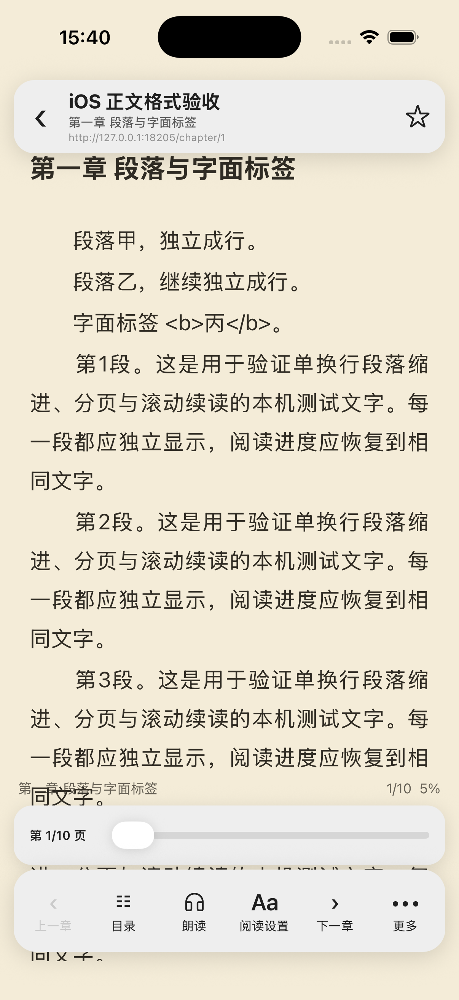
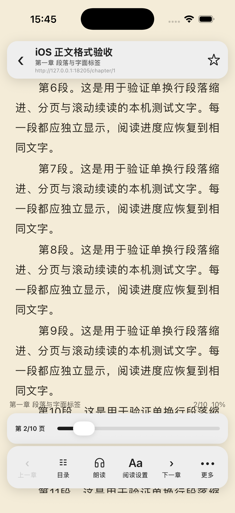

# 2026-10-29 正文格式与阅读段落 / Content formatting and reader paragraphs

这是完整 1:1 还原目标的一项进展。源 Kotlin/布局仍为规格，仅在独立 Legado HTYF 调试 iPhone 17 Pro / iOS 26.5 模拟器验收；没有 Android 构建或设备操作。

## 差异与映射

实际正文加载入口先复现三项差异：相邻 div 合并、p 起始边界丢失、实体反复解码后把字面标签删除，见 [red.log](red.log)。随后另行复现单换行段落无法定位和分页丢失首段缩进，见 [position-red.log](position-red.log)、[pagination-red.log](pagination-red.log)。

- [htmlFormatter.ts](../../../src/core/htmlFormatter.ts) 对照原版 HtmlFormatter 的处理顺序、区分大小写的标签表达式、Java ASCII 空白、图片属性优先级与地址拼接。原版存储阶段的全角缩进和末尾缩进行保留，显示前再执行段落处理。
- HTML4 实体在删标签后只解码一次；252 个 HTML4 命名实体有独立原版对照。XML 的 apos 和 HTML5 专有命名实体保持字面值，数字引用保留原版语义。
- [webBook.ts](../../../src/core/webBook.ts) 接入在线正文格式化，全文替换在原始格式化结果上执行，再转换为阅读图片/富文本标记。音频和视频内容保持原文；漫画保留图片 HTML，供其图片解析器使用。
- [readerImages.ts](../../../src/core/readerImages.ts) 对已经格式化的在线内容只适配图片与 usehtml，不再删除解码出来的字面标签。关闭特殊格式时调用相同的原版清理流程；EPUB 原有转换入口暂未改为这套在线流程。
- [sourceRegex.ts](../../../src/core/sourceRegex.ts) 对齐本次用到的 i/m/s 前缀和 Java 美元锚点，包括末尾换行前的位置；不据此认定完整 Java 正则兼容。
- [ReaderPositionBridge.tsx](../../../src/components/ReaderPositionBridge.tsx) 与阅读页都按单换行段落测量；显示段落先去掉存储缩进，再应用一次用户缩进。分页切片保留配置的缩进和对应 UTF-16 范围。

原有少数正文测试期待未经原版格式化的字符串，现按原版存储结果验证；全文替换夹具也改用源协议的 `##广告##`，不再把 `广告##` 当成同一规则。

## 原版对照

[参考生成器](../../../scripts/content-format-reference.py) 直接编译未改动的完整 HtmlFormatter.kt。URL 方法及两个字符串判断从源文件原样提取，Android 日志仅隔离为无输出；HTML4 解码使用源工程声明的 Apache Commons Text 1.13.1。BookContent 的保护/解码/固定前缀全文替换和 ContentProcessor 最后的段落循环在 JVM runner 中单独重放，未声称执行完整 ContentProcessor 类。

[639 组夹具](../../../__tests__/fixtures/contentFormat.native.json) 全部一致，覆盖格式化、简介模式、HTML4 实体、图片地址与参数保留、特殊格式、最终段落及 72 项正则锚点案例。原文件、JAR 哈希和分项数量见 [acceptance.json](acceptance.json)。这不包含完整 URL handler/Java 正则语法矩阵。

```bash
python3 scripts/content-format-reference.py \
  --source-root /Users/dgz/code/github/legado \
  --kotlin-lib /Users/dgz/.gradle/wrapper/dists/gradle-9.3.1-bin/23ovyewtku6u96viwx3xl3oks/gradle-9.3.1/lib \
  --commons-text-jar /private/tmp/legado-ios-debug/content-format/commons-text-1.13.1.jar \
  --commons-lang-jar /Users/dgz/.gradle/wrapper/dists/gradle-9.3.1-bin/23ovyewtku6u96viwx3xl3oks/gradle-9.3.1/lib/commons-lang3-3.20.0.jar \
  --output __tests__/fixtures/contentFormat.native.json
```

重用上一轮同一份 59,052 字节的真实「阅读书屋」响应及原版 `.calibre@html` 的 9,281 单元提取结果。原版与目标格式化后均为 7,636 UTF-16 单元，严格相等，UTF-8 SHA-256 为 `aed23df07e4e3e5a93f7677fabf2a340ea4b617c0f1f9e6e7491430e52fd9390`。再执行原书源未改动的全文替换规则，两者均为 7,510 单元，哈希为 `cd53f507c26e9c54872e6ea5dd282d2d7c66d39348bf69df3dc6505cfab28579`。

格式化结果的原版最终段落循环也与目标一致：61 段、7,631 单元。该对照的具体阶段、输入和输出摘要见 [real-comparison.json](real-comparison.json)；完整第三方响应及其正文仅保存在临时目录，未加入仓库和生产包。生成器的 `--html-file`、`--mode paragraphs` 和 `--replacement-rule-file` 可重放对应阶段。

## 独立 iOS 验收

`scripts/content-format-fixture.mjs` 仅监听 127.0.0.1:18205，生产入口不引用。经真实搜索、详情、目录和正文加载加入一本临时书；首屏能看到独立段落、每段一次缩进和字面 `<b>丙</b>`。



在滚动阅读模式使用正常可访问性进度控件定位第 2/10 页，保存 UTF-16 游标 352；终止进程，连接专用 Repack 8097 再启动，重新打开此书后仍为 352。重启前后首个可见段落均为第 6 段，位置一致。物理拖动/滚动自动化遇到 Simulator 控制层 noWindowsAvailable，未将它计为物理手势验收通过；本项验证的是测量段落定位与重启恢复。




真实书源只复制为临时源，并把目录限定到原第 2～3 项以避开前两项前置页；正文与全文替换规则不改。UI 四阶段成功：搜索 1 条，详情成功，目录 2 章，正文 7,510 字符。


通过正常 API 移除本轮临时书和两条临时源后，原有 9 本书与 8 条书源的完整记录逐字段一致。18205 临时服务已停止；结束时 Web/MCP/定时任务均关闭，模拟器停留在原书架。原有阅读偏好未切换。

## 验证与交付

全量 200 suites / 990 tests、TypeScript、改动代码 ESLint 和 diff check 通过，见 [tests.log](tests.log)、[最终核对](final-verification.json)。本轮没有新增依赖；package.json、npm/yarn 锁文件、目标原生目录及源工程保持不变。

官方 CLI 0.7.9 构建 iOS 0.0.33：[包摘要](package.json)、[318 个生产输入](production-inputs.json)、[Worklet 审计](worklet-audit.json)。压缩完整性、原有 MIT/BSD 许可证和分享二维码像素内容通过；460 个数组闭包、0 个意外闭包赋值，两个未调用的库内 Jest 辅助函数单独记录。构建有两项现有库警告：BottomSheet 的可选 FlashList 和 Reanimated Jest 动态 require；不把它们算作新增功能验收。

本地包未上传，远程当前仍为 0.0.27，见 [远程只读复核](remote-availability.json)。实际 HTYF 宿主/真机加载仍 pending。完整 ContentProcessor、简介/EPUB、富文本/媒体/图片请求参数渲染、Java 正则/URL 边缘合同、物理手势、JS 沙箱及全量迁移清单继续待实现或验收；完整 1:1 目标仍 active。

The unchanged native HtmlFormatter and isolated BookContent/final-paragraph stages match 639 reference cases. The same real response matches at 7,636 UTF-16 units after formatting and 7,510 units after the original source-wide replacement. The separate final-paragraph pass also matches. Full ContentProcessor execution is not claimed.

The independent iOS simulator verifies separate paragraphs, one configured indent, literal tags, the real-source four-stage flow, and measured scroll-reader cold restoration at cursor 352/page 2 of 10. Restoration was triggered through the normal accessibility progress control; physical gesture acceptance remains pending because the Simulator control layer could not perform drag/scroll. The temporary book/two sources were removed, nine original books/eight sources were preserved, and temporary services were stopped.

All 200 suites/990 tests, TypeScript and changed-code ESLint pass. This iteration changes no dependencies or native source. The local 0.0.33 package, 318 production inputs, licenses, worklet closures and QR are verified. The remote version remains 0.0.27; deployment, actual HTYF-host/device acceptance and the remaining full migration inventory remain pending.
