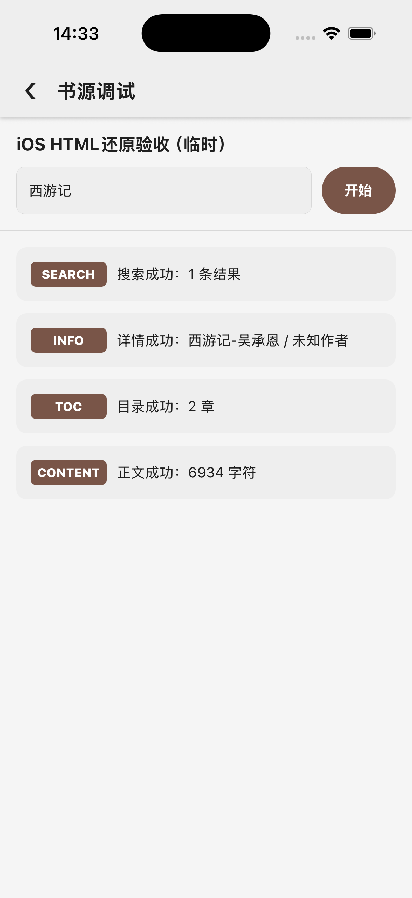
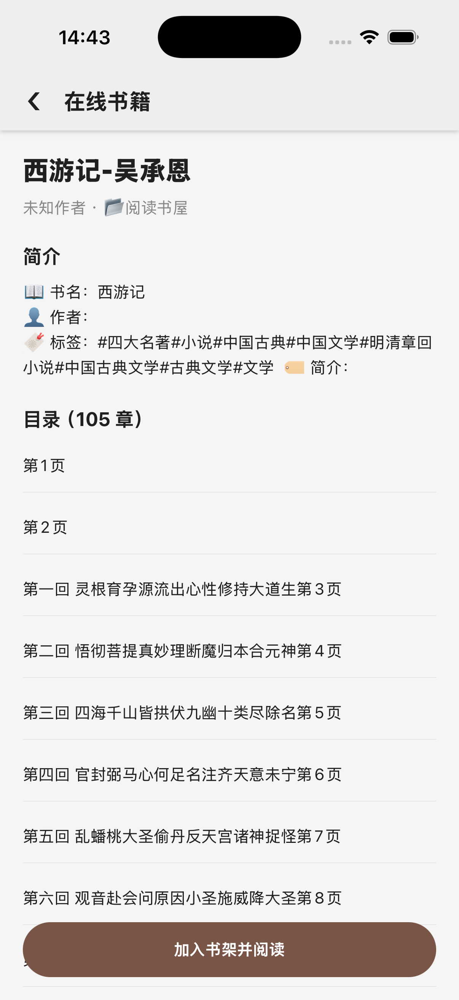
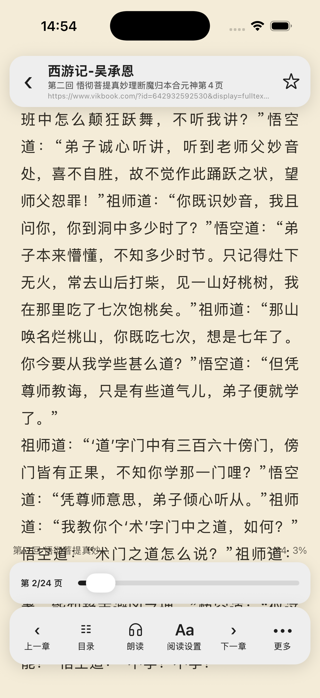

# 2026-10-29 集合 HTML 提取与序列化 / Collection HTML serialization

这是完整 1:1 还原目标的一项进展。源 Kotlin/布局仍为规格，原工程只读；仅使用独立 Legado HTYF 调试 iPhone 17 Pro / iOS 26.5 模拟器，没有 Android 构建。

## 原版合同与映射

原版 AnalyzeByJSoup.getResultLast 的 html/all 都返回整组选中元素的 outerHtml 单项结果，元素间以换行连接。html 先在原 DOM 上执行 script、style 的节点移除，all 保留；选中列表仍按原版保留对象引用，单独选中 script/style 时移出 DOM 不等于从列表中丢弃该对象。它不是任意 HTML 的安全净化接口。

- htmlDom.ts 使用固定 parse5 7.3.0 和 htmlparser2 适配器 7.1.0 进行 HTML5 树修复，保留无等号属性、自闭合和模板节点结构。按原版 <?xml 前缀选择 XML 解析。Jsoup 对未知 HTML 自闭合标签的扩展也按其原逻辑闭合。
- htmlTagMetadata.ts 统一固定 Jsoup 1.16.2 标签属性，保留 XML 命名空间标签在移出文档后的属性；数据节点身份也单独保留，避免将 XML 文本误当成 HTML script/style 原始数据。
- htmlSerialization.ts 实现集合级外层序列化、单空格缩进、最大 30 空格填充、行内/块级规则、属性折叠、实体、注释、CDATA 与 HTML/XML 输出语义。移除节点会改变原有 DOM，组合规则的分支共享同一解析文档，保持原版副作用。
- readerImages.ts 在创建图片/标题/富文本标记之前忽略序列化排版空白，保留 usehtml 原文和原有语义标记边界。完整原版正文净化及阅读段落/视觉仍另有待验收范围。

四项最小症状先失败，见 [red.log](red.log)。原 XPath 测试原先在未声明 XML 的页面期待处理指令节点；现按原版将声明 XML 和 HTML 中的伪注释分别验证。新解析器引出的排版空行回归已修复，原图片、标题、ruby 与富文本测试继续通过。

## 原版和真实网页对照

[参考生成器](../../../scripts/html-text-reference.py) 直接运行未改动的 AnalyzeByJSoup.kt、RuleAnalyzer.kt，使用固定 Jsoup 1.16.2 / JsoupXpath 2.5.3；仅替代无解析行为的 Android Keep 注解，不编译 Android 工程。

109 组序列化输出全部一致，涵盖集合/组合副作用、属性/实体、预格式、脚本/样式、深层缩进、模板/表格、未知自闭合标签、XML/CDATA 和移出 XML 文档后的标签格式，见 [原版夹具](../../../__tests__/fixtures/htmlSerialization.native.json)。

```bash
python3 scripts/html-text-reference.py \
  --source-root /Users/dgz/code/github/legado \
  --kotlin-lib /Users/dgz/.gradle/wrapper/dists/gradle-9.3.1-bin/23ovyewtku6u96viwx3xl3oks/gradle-9.3.1/lib \
  --jsoup-jar /private/tmp/legado-ios-debug/selector-index/jsoup-1.16.2.jar \
  --xpath-jar /private/tmp/legado-ios-debug/html-text/jsoupxpath-2.5.3.jar \
  --serialization --output __tests__/fixtures/htmlSerialization.native.json
```

另外对真实「阅读书屋」第一回同一份 59,052 字节响应运行 .calibre@html。原版和目标均输出 1 项、9,281 UTF-16 单元，逐字符串严格相等，结果列表 JSON 的 UTF-8 SHA-256 均为 d6fdf81c855eafdcc3e859849c09383830788af17b3d23de63ffa6e84ac526ba。输入及结果摘要见 [real-comparison.json](real-comparison.json)。完整第三方响应/原版输出只保存在临时目录，没有加入仓库或生产包。

可用生成器的 --html-file / --rule 参数对同一响应重放；该真实页面不是永久不变的测试夹具，应先核对记录的输入哈希。

## 独立 iOS 验收

以原始「阅读书屋」的临时副本限定原目录第 2～3 项（第一回、第二回），正文规则不改。UI 四阶段调试成功：搜索 1 条，详情成功，目录 2 章，正文 6,934 字符。该数字是阅读转换后的正文，不是前面严格对照的原始 HTML 长度；没有把它宣称为原版 HtmlFormatter 完整流程的字符等值证明。



删除临时副本后，原有 9 本书和 8 条书源的完整记录与添加前逐字段一致，没有加入测试书籍。原始书源重新限定搜索后仍展示 105 项目录，规则未改。



终止进程后从独立 Repack 8097 重新启动，原有《西游记》恢复到第二回第 2/24 页。结束时 Web 服务、MCP 服务、定时任务均关闭，模拟器停留在书架。



## 构建与依赖

只新增固定的纯 JavaScript parse5 / 适配器；原有依赖版本、全部原有包的 npm 锁定解析条目（根清单除外）与目标 ios/android 目录不变。Yarn 仅新增相应解析器条目。目标原生代码未改。

官方 CLI 0.7.9 生成 iOS 0.0.32。316 个生产输入包括新增解析器模块、锁文件和许可证，见 [production-inputs.json](production-inputs.json)。包完整性、MIT/BSD 许可声明保留和二维码像素解码均通过。新增依赖许可证在 [parse5](../../licenses/parse5-MIT.txt)、[适配器](../../licenses/parse5-adapter-MIT.txt)、[entities](../../licenses/parse5-entities-BSD.txt)；许可在压缩后、签名/清单处理前嵌入 bundle。

[Worklet 审计](worklet-audit.json)：460 个数组闭包、0 个旧格式已编译闭包、0 个语法错误；两个未调用的库内 Jest 辅助函数仍保留对象闭包。全量 198 suites / 975 tests、TypeScript、改动代码 ESLint 与 diff check 通过，见 [tests.log](tests.log)、[acceptance.json](acceptance.json)。

本轮未上传生产包，真实红糖云服宿主/真机加载仍待验收。远程配置和包地址的只读复核见 [remote-availability.json](remote-availability.json)，可用 URL 本身不证明该本地包已部署。完整显式 CSS/混合规则语法、HTML5/XML 声明/命名空间边缘矩阵、原版 HtmlFormatter/ContentProcessor 与阅读段落/位置/视觉矩阵、JS 沙箱以及全量迁移清单仍未全部完成，不以这些对照或打包推断整个 1:1 目标达成。

Collection html/all extraction now follows native outer-HTML, DOM cleanup, shared-branch effects and serialization rules. All 109 native fixture outputs match. The same real 59,052-byte chapter response produces an identical one-item, 9,281-unit serialization result in Kotlin and the target.

All 198 suites / 975 tests, TypeScript and changed-code ESLint pass. The independent iOS simulator passed real-source search/details/two-chapter/content debugging, and the original source still exposes 105 TOC items. A cold process restart restored the existing book at chapter two, page 2/24. Web/MCP services and scheduled tasks were off at the end. The temporary source was removed and nine books/eight original sources were preserved. Only two pinned pure-JavaScript dependencies were added; existing pins and native directories remain unchanged. Production 0.0.32 and its licenses/QR/ABI are audited; deployment and real HTYF-host/device acceptance remain pending. Full parser/CSS/reader formatting, JavaScript and overall UI parity remain open.
