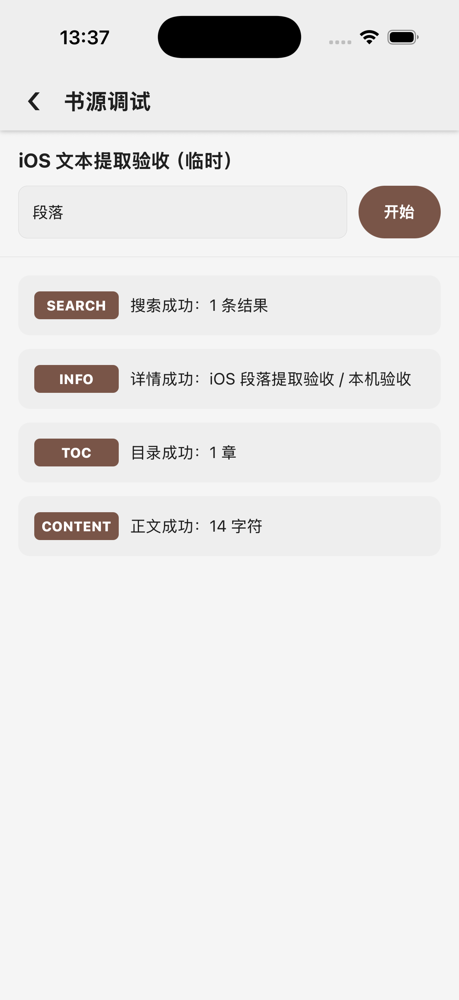
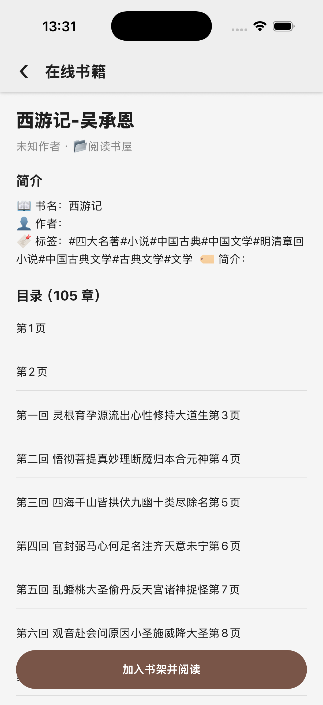

# 2026-10-29 HTML 文本提取语义 / HTML text extraction parity

这是完整 1:1 还原目标的持续进展。只在独立 Legado HTYF 调试 iPhone 17 Pro / iOS 26.5 模拟器运行验收；没有 Android 构建。源工程、目标原生目录和运行时依赖版本保持不变。

## 原版合同与实现

对照原版 AnalyzeByJSoup.getStringList/getResultLast，以及固定 Jsoup 1.16.2 的 Element、TextNode、Tag 和 StringUtil：

- text 按原版块元素/br 边界补空格，不混入 script/style 的数据节点或注释。
- ownText 只取直接文本和 br；textNodes 分别规范化直接文本、去空项并以换行拼接，不能将段落粘连。
- pre/textarea/title/plaintext 的保留空白、最多六层祖先检查、ASCII 端点修剪、NBSP、零宽空格/软连字符及其它 Unicode 空白按原版处理。
- 普通属性大小写读取兼容，跳过原版定义的空白值，对原始属性值去重后再应用替换；普通文字保留重复项。字符串链允许自定义终端属性，元素列表仍保持自己的选择器路径。
- 标准 && 拼接、|| 首个非空与 %% 交错保留结果列表边界；原版交错长度由第一个非空结果决定，不能改成长列表最大长度。HTML 元素列表的 && 结果也不再压成文字。

新增 src/core/htmlText.ts 隔离可见文字合同，core/sourceRule.ts 将其接入提取路径。正文加载回归贯穿 loadChapterContent，锁定三段直接文本为 `第一段\n第二段 续行\n第三段`。

五项初始症状均先复现失败，见 [red.log](red.log)。旧 textNodes 的 headbetween 预期根据原版修正为 head 与 between 两行。

## 直接运行原版分析类

[参考生成器](../../../scripts/html-text-reference.py) 逐字复制源 AnalyzeByJSoup.kt 和 RuleAnalyzer.kt，使用本机 Kotlin 编译器、Jsoup 1.16.2 和 JsoupXpath 2.5.3 运行。仅用无行为的 Keep 注解替身解决 Android 编译期注解；没有替换分析逻辑或编译 Android 项目。

103 组原版输出全部匹配，覆盖块/行内/未知标签、数据节点、注释、Unicode、pre 深度、重复/空属性、自定义属性链与标准组合列表。源文件及参考 JAR 哈希见 [原版输出夹具](../../../__tests__/fixtures/htmlText.native.json)，生成摘要见 [reference-generate.log](reference-generate.log)。

```bash
python3 scripts/html-text-reference.py \
  --source-root /Users/dgz/code/github/legado \
  --kotlin-lib /Users/dgz/.gradle/wrapper/dists/gradle-9.3.1-bin/23ovyewtku6u96viwx3xl3oks/gradle-9.3.1/lib \
  --jsoup-jar /private/tmp/legado-ios-debug/selector-index/jsoup-1.16.2.jar \
  --xpath-jar /private/tmp/legado-ios-debug/html-text/jsoupxpath-2.5.3.jar \
  --output __tests__/fixtures/htmlText.native.json
node node_modules/jest/bin/jest.js --runInBand
node node_modules/typescript/bin/tsc --noEmit
```

参考依赖来自 Maven Central 的固定版本。最终 197 suites / 967 tests、TypeScript、改动代码 ESLint 和 diff check 通过，见 [tests.log](tests.log)、[acceptance.json](acceptance.json)。

## 独立 iOS 验收

[scripts/html-text-fixture.mjs](../../../scripts/html-text-fixture.mjs) 只监听 127.0.0.1:18204。通过正常应用 API 导入临时书源，UI 书源调试依次成功：搜索 1 项、详情、目录 1 章、正文 14 字符。返回页面故意在三个直接文本段落之间夹入子元素和脚本，预期值同时被原版夹具和正文加载测试锁定；截图只直接证明四阶段及字符计数，没有声称展示阅读页的三行排版。



原始「阅读书屋」限定搜索《西游记》后，详情模板和 105 项目录仍正常，源规则未修改。



没有加入测试书籍。移除临时副本后，正常 API 对比本次添加前/删除后的 9 本书和 8 条书源完整记录一致。请求轨迹见 [fixture-requests.json](fixture-requests.json)。验收服务器已停止，Web/MCP/自动任务恢复关闭。最终代码通过既有 8097 调试服务冷启动，书架仍为 9 本，恢复第二回第 2/24 页，见 [冷启动证据](cold-resume.png)。

## QuickJS 能力复核

本机宿主仓库固定 react-native-quickjs-sandbox 1.0.1，而目标未固定该依赖。只读检查确认暴露 createContext/disposeContext/registerHostCallback/evalCode/executePendingJobs，evalCode 直接同步调用 JS_Eval；包装层没有设置中断、内存上限或栈上限的接口。精确文件哈希与方法见 [quickjs-audit.json](quickjs-audit.json)。没有启用任意书源脚本、调用不受限 eval 或修改宿主/目标原生代码；不能将“宿主仓库存在模块”当作该迁移能力已完成。真机已安装宿主二进制版本未核对。

## 构建、许可与剩余范围

官方 CLI 0.7.9 构建 iOS 0.0.31。309 个生产输入见 [production-inputs.json](production-inputs.json)，包完整性通过。Jsoup 的 MIT 许可保存在 [许可证](../../licenses/jsoup-MIT.txt)，Webpack 精确保留移植代码的该许可，最终 bundle 已检查包含完整声明。

[Worklet 审计](worklet-audit.json) 为 460 个数组闭包、0 个旧格式已编译闭包、0 个语法错误；两个未调用的库内 Jest 辅助函数仍使用对象闭包。二维码像素与最终配置/分享链接一致，包中不含本机验收数据。生产包未发布，真实红糖云服宿主/真机加载待验收。

本项没有完成集合级 html/all 的外层 HTML 序列化与 script/style 删除、完整显式 CSS 模式、混合规则语法和 HTML5/XML 解析边缘合同；这些继续作为纯 JS 还原工作，不能以当前测试推断已通过。任意 JS 沙箱、完整 UI/交互矩阵等全量清单亦未完成。

Native text/direct-text/attribute extraction now matches 103 outputs from the unchanged Kotlin analyzer. Block boundaries, Unicode/preformatted whitespace, direct-text line boundaries, raw-attribute deduplication and standard list combinations are covered. All 197 suites / 967 tests, TypeScript and changed-code ESLint pass.

The independent iOS simulator passed all four debug stages for a controlled three-line, 14-character response. The original real source still returns 105 TOC items. The temporary source/server were removed and all nine books/eight original sources were preserved around that verification. A final cold start resumes the original book at chapter two, page 2/24. Production 0.0.31 is built and audited, with the Jsoup MIT notice retained in the bundle; deployment and actual HTYF-host/device acceptance remain pending. General JavaScript, full HTML serialization/parser/CSS grammar, and the complete UI/interaction inventory are still open.
