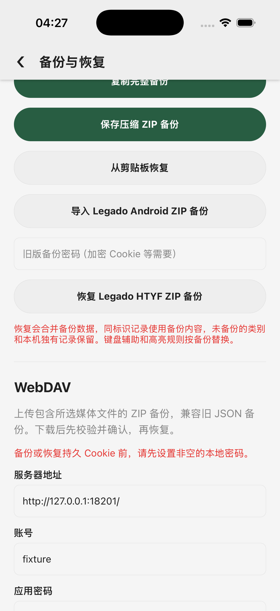
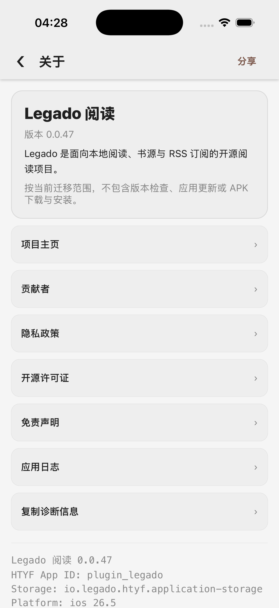
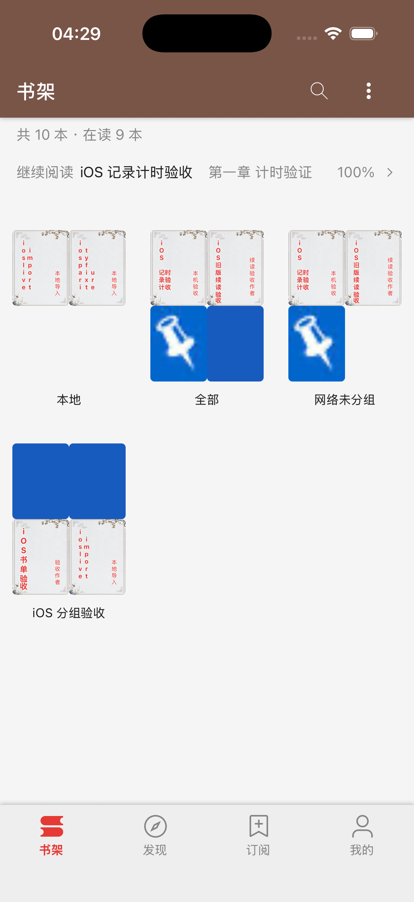

# 原版敏感备份预校验 / Native sensitive-backup preflight (0.0.47)

原版 `Restore.kt` 在书架等普通数据写入前，先按 Cookie → 源变量顺序校验敏感文件。原目标实现会把密码错误转成“跳过加密数据”的警告，仍允许其他数据恢复；明文源变量还绕过了非空密码要求。本轮纠正这一失败边界，**整体 1:1 与完整加密恢复交互验收仍未完成**。

Native `Restore.kt` validates cookies and then source-variable caches before ordinary data writes. The target previously downgraded decryption failures to warnings and allowed other categories to restore; plaintext caches also bypassed the password requirement. This release corrects that boundary. **Overall parity and complete encrypted-restore interaction remain pending.**

## 修复与参考证据 / Changes and reference evidence

- `nativeBackupPreflight.ts` 对未忽略的 Cookie 强制解密；源变量仅在原版 `isJsonArray` 条件成立时允许明文，但两者均要求非空白本地密码。所有预校验错误会阻止预览，不生成可确认的部分恢复。忽略选项在读文件前生效。
- `nativeBackupSensitive.ts` 对齐严格 JSON、无空项对象列表、字段类型、URL 空白、允许的变量前缀、非负 Long、重复字段及重复变量键。Long 超出 JS 安全整数时使用已有无损字符串表示。空列表不生成新存储项。
- 本地 ZIP、WebDAV 和旧版导入默认使用已配置本地密码；旧版密码框保留显式临时覆盖，不保存覆盖值。HTYF 自身备份仍用既有原子恢复路径。
- `legacyBackupCrypto.ts` 对齐 BackupAES 的 MD5 前 16 个小写十六进制字符密钥、AES ECB/PKCS5、Hutool 十六进制优先及标准/URL-safe Base64、原版允许的空密文和 UTF-8 解码。服务器配置仍保留原版非致命错误策略。

Preflight is fatal and ordered; ignored files are skipped before reading. Strict rows preserve exact Longs and native duplicate semantics, and empty lists do not create persistent data. Archive paths default to the current local password, while the legacy field provides a temporary override. The existing HTYF atomic restore contract remains covered. Crypto follows the native MD5/AES envelope and finite Hutool decoding cases; server errors remain nonfatal.

[复现脚本](../../../scripts/native-restore-preflight-reference.py)编译未改动的原版 `BackupAES`、`MD5Utils`、完整 Gson 扩展、Cookie/Cache 实体，以及从 `Restore.kt` 原样提取的两个严格解析函数。Room 仅注解替身，没有 Android/Room 运行。固定库为 Gson 2.14.0、Hutool core/crypto 5.8.22，均只保存在临时目录用于验证；未增加运行依赖。

The reference compiles unchanged source classes and extracted parser functions with pinned Gson/Hutool. Room annotations are stubbed; no Android application is built. JAR/source hashes and JVM identity are in [native-comparison.json](native-comparison.json).

**349** 个解析输入（77 接受 / 272 拒绝）、**336** 个加密封装（258 可解密）与目标逐项相符。用例仅包含公开的自建 fixture 密码和值，不含用户凭据。Jest 加密层使用 Node 真实密码学，不能替代 iOS QuickCrypto 验收。

All **349** parser cases and **336** envelope cases match. Test inputs contain public fixture values only. Node cryptography is real, but does not prove iOS QuickCrypto behavior.

```bash
python3 scripts/native-restore-preflight-reference.py \
  --source-root /Users/dgz/code/github/legado \
  --kotlin-lib /Users/dgz/.gradle/wrapper/dists/gradle-9.3.1-bin/23ovyewtku6u96viwx3xl3oks/gradle-9.3.1/lib \
  --gson-jar /private/tmp/legado-ios-debug/read-records/gson-2.14.0.jar \
  --hutool-core /private/tmp/legado-ios-debug/native-restore-preflight/hutool-core-5.8.22.jar \
  --hutool-crypto /private/tmp/legado-ios-debug/native-restore-preflight/hutool-crypto-5.8.22.jar \
  --output __tests__/fixtures/nativeRestorePreflight.native.json
```

## 测试与 iOS 边界 / Tests and iOS limits

最初三个用例确实失败，见 [red.log](red.log)：错密码、无密码明文变量、非法敏感项均未按原版中止。修复后 **220 suites / 1,118 tests**、TypeScript、改动文件 ESLint 通过，见 [tests.log](tests.log)。完整预览→恢复回归证明，预校验失败保留已有书源及布尔/数值项；合法加密变量合并保留本地独有项。

The initial three tests failed on the actual error boundary. The final suite passes **220 suites / 1,118 tests**, type checking and changed-file lint. Integration tests exercise real conversion/restore logic with an in-memory storage adapter and Node crypto; filesystem/archive operations alone are mocked.

本轮 CUA 曾出现原生 pipe 关闭、`noWindowsAvailable` 和 ScreenCaptureKit 暂态错误，稍后重新绑定恢复。没有通过错误推断应用死亡，也没有改用终端发送 UI 输入。原 Repack PID 35753 与监听均已确认消失后，才恢复为 PID 92620 / `127.0.0.1:8097`。所有输入均检查 Legado 专用窗口；未操作其他设备数据。

Transient CUA native-pipe/window/capture failures recovered through rebinding. They were not treated as application termination. The old Repack process/listener were confirmed absent before restarting the same loopback service. Every UI input stayed in CUA and checked the dedicated Legado window.

同一独立设备 `8338CC2C-E716-4B2B-BC30-CC5C777CB2FD` 的正常 WebDAV 下载验证了三条路径，见 [ui-evidence.json](ui-evidence.json) 和不含请求头/正文的 [requests.json](requests.json)：

1. 含合法加密 Cookie 空列表及原有测试源的 ZIP，在本地密码为空时显示“备份或恢复持久 Cookie 前，请先设置非空的本地密码。”，无恢复确认。
2. 含合法明文源变量及原有测试源的 ZIP，仍显示源变量密码要求，无恢复确认。
3. 只含原有测试源的普通 ZIP 正常进入 `bookSource.json` 确认预览，然后取消；没有确认恢复、修改本地密码或切换忽略选项。

The normal WebDAV UI rejects both encrypted cookies and plaintext runtime caches when the local password is blank, before confirmation. A source-only control reaches the normal preview and is cancelled. No restore was confirmed, password changed or ignore preference toggled.



前后均通过应用“保存压缩 ZIP 备份”正常生成备份，再只读其中 `backup-htyf.json` 比较：**27 项带类型存储逐值完全一致**，测试前也与 `.46` 最终导出一致。[preservation.json](preservation.json) 仅保存数量/哈希；完整导出只留在临时目录，没有直接读取 MMKV。取消系统导出面板后，应用自身清理本轮两份缓存 ZIP；未手动删除之前待确认的测试数据或旧文件。

Normal before/after ZIP exports prove **all 27 typed entries remain exactly equal**, and the starting entries match the `.46` final export. Reports contain counts/hashes only; full exports remain private temporary files. The application cleans its two generated cache ZIPs when the export panels are cancelled; no prior pending fixture deletion was attempted.

关于页确认版本 `.47`、iOS 26.5、React Native 0.86.2 和独立存储命名空间。初次冷启动 PID 96732，测试后冷启动 PID 18302，仍显示 10 本 / 在读 9 本；Web/MCP/定时任务在冷启动后均为关闭，回环测试服务已停止。

The About page confirms `.47`, iOS 26.5, RN 0.86.2 and the dedicated storage namespace. Source cold starts before and after the checks render 10 books / 9 in reading. Web/MCP/tasks remain off after the final cold start, and the loopback fixture server is stopped.





**正确非空密码下的 iOS QuickCrypto 解密及恢复、忽略选项的设备矩阵仍待验收**，当前不能据 Node 对照宣称通过，也未验证 `.dgz` 在真实 HTYF 宿主加载。后续继续完成这些项；不将目标自动续跑视作旧临时数据的删除授权。

**Correct-password iOS QuickCrypto restoration and ignore-switch device matrices remain pending.** Node comparisons do not prove them, and the `.dgz` has not been accepted in a physical HTYF host. Previous fixture cleanup still requires the pending explicit confirmation.

## 交付与未完成项 / Delivery and remaining work

本地 iOS `.47` 包、冻结输入、闭包/语法/许可证检查与二维码逐像素解码见 [package.json](package.json)、[production-inputs.json](production-inputs.json)、[worklet-audit.json](worklet-audit.json)、[qr-verification.json](qr-verification.json)。打包审计另发现既有 Jsoup MIT 声明只在仓库、未被加入 banner；本轮补入产物，原版代码和依赖不变。构建仍有现存的可选 FlashList 缺失、Reanimated Jest 导出及 SDK 版本/弃用警告，不能视为全量宿主兼容通过。

The local iOS `.47` artifact has frozen-input, syntax/worklet, license and QR verification. Artifact inspection additionally found the existing Jsoup MIT notice was missing from the banner; this release includes it. Dependencies and native projects are unchanged. Existing optional FlashList, Reanimated Jest export and development SDK/version/deprecation warnings remain open.

远程仍为 **0.0.34**、配置 GET / 包 HEAD **200/200**，本地 `.47` 未发布，见 [remote-availability.json](remote-availability.json)。真机 HTYF 宿主待验收。

Remote config remains **0.0.34**, with config GET/package HEAD **200/200**. Local `.47` is unpublished and physical HTYF-host acceptance is pending.

本轮没有完成 CookieStore 二级域/会话/按名合并、带 `|` 的原始记录、源变量运行时消费者、所有 Gson/密码 Unicode/解码边界、原版 XML/配置、全部 DAO 约束、错误日志、取消/进程/连续存储失败、大文件及全应用视觉/无障碍/手势矩阵。历史 `.46` 的“crypto preflight pending”只在上述有限、可验证子集内推进，不能据此关闭全量恢复或整体目标。结构化状态见 [acceptance.json](acceptance.json)。

CookieStore domain/session/name merging, raw `|` entries, runtime consumers, exhaustive JSON/password/charset cases, native configuration/XML, DAO constraints, logging, interruption/storage failures, large inputs and full visual/accessibility/gesture/host matrices remain open. This closes only the evidenced preflight subset, not complete restoration or global parity.
