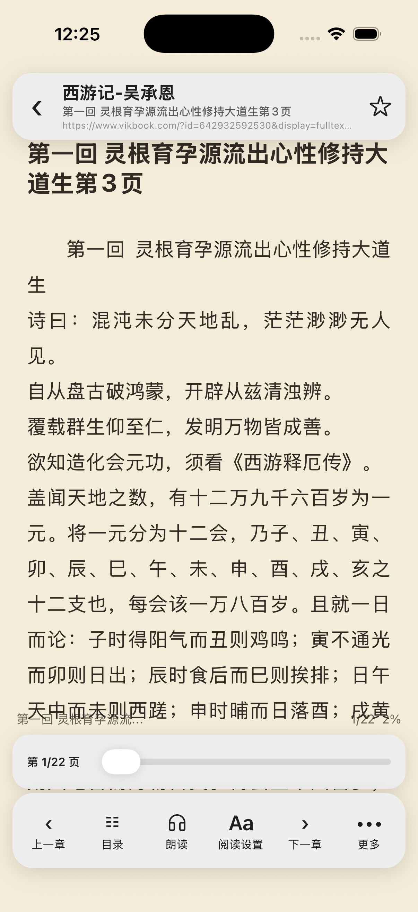
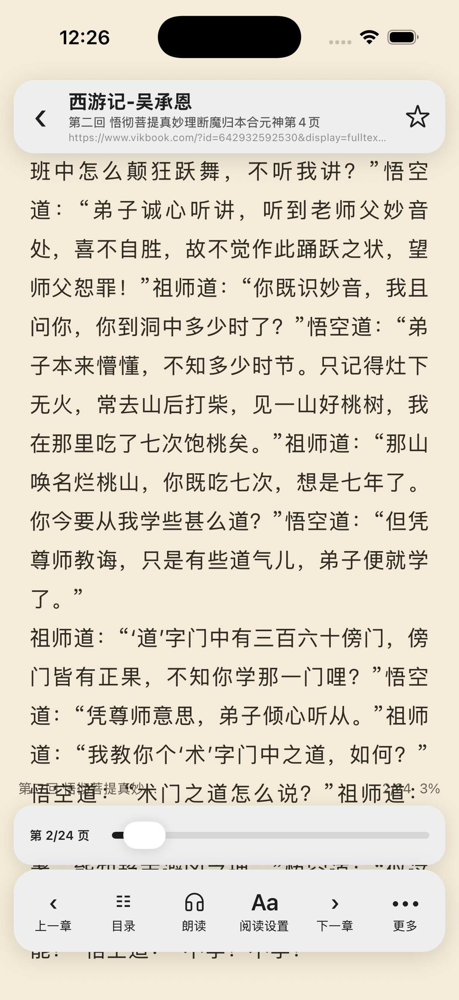

# 2026-10-29 真实书源验收

用户提供的 [1321.json](https://www.yckceo.com/yuedu/shuyuans/json/id/1321.json) 返回 836 条书源，共 9,302,369 字节。下载快照 SHA-256：`761f4a91086a40a0c22bb50702fe7152ee3854ca55286292e26101a4e2ca7390`。本轮从中选择第 98 条「📂阅读书屋」进行普通文字验收，没有一次搜索整个集合。可再次导入的原始单源文件为 [vikbook.json](vikbook.json)，源规则未修改。

在独立 Legado HTYF 调试 iPhone 17 Pro / iOS 26.5（8338CC2C-E716-4B2B-BC30-CC5C777CB2FD）通过应用正常 saveBookSource 接口合并导入，再通过 UI 进入该源限定搜索。书源从 7 条增至 8 条，其余七条保留。搜索《西游记》得到「西游记-吴承恩」，详情得到 105 个目录项目（含扉页），加入书架后第一回和第二回均加载真实网站正文。

第二回前进到第 2/24 页，退出后应用正常 API 记录章节索引 3、字符位置 366。原有八本书完整记录逐字段相同，新增书后共九本。原书架、旧书源和阅读设置均未主动改写；Web/MCP/自动任务在最后恢复关闭。冷启动再次恢复第二回第 2/24 页，截图 [cold-resume.png](cold-resume.png)；结构化结果见 [acceptance.json](acceptance.json)。

## 暴露并修正的兼容问题

真实搜索网页含一个匹配结果，但应用原先返回空列表。原版书源使用 `#page@div[itemscope]` 查列表、`#content@.page` 查目录，目标解析器错误地把第二段当成终端属性读取。已扩展两段 CSS 链识别，保留属性读取和 XPath 独立路径；不需要改动真实源规则。

`sourceRule.test.ts` 使用最小真实结构验证列表节点、名称/链接提取、CSS 前缀、目录链和自定义属性；先失败后通过，红/绿日志保存在本目录。全套 195 suites / 926 tests、TypeScript、改动代码 ESLint 通过。

## 验收边界

本轮验证单一书源的搜索→105项目录→两章正文→定位保存，不能推导整个 836 条集合可用。搜索结果未提供作者，详情作者/简介模板尚未完整解析，显示仍有缺口；单页进度条的无障碍百分比显示也有待修正。没有把这些问题标为通过。

使用独立模拟器，不涉及 Android 或目标原生改动；数据经应用正常 API 和 UI 操作，没有直接访问 MMKV。新构建包仅用于本地交付，真实宿主和手机验收仍需另外进行。

本地交付包 `dist/dist.dgz` 版本 0.0.28，1,611,597 字节，SHA-256 `ac3ea4b95c46c41f41eb7d4ebc0a127ab19a42b54944da7236a5fa0336a98d92`。308 项构建输入摘要见 production-inputs.json；成品 460 处编译 worklet 均为宿主数组闭包协议，见 worklet-audit.json。书源仅导入模拟器数据，不作为默认源硬编码进包。
