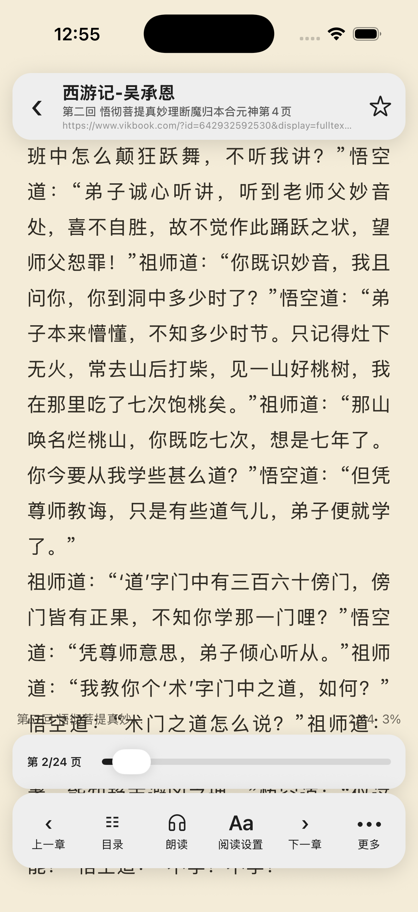

# 2026-10-29 书源元数据规则还原

完整迁移目标继续进行。本轮由真实「阅读书屋」元数据的空书名、残留模板和错误封面地址推动；源工程只读，仍在独立 iOS 调试。前一轮真实书源验收构成已完成进展，未将其视为全应用完成。

## 原版合同

对照源 `model/analyzeRule/AnalyzeRule.kt` 的 SourceRule 构造、makeUpRule、getString、replaceRegex，以及 AnalyzeByJSoup/AnalyzeByXPath/AnalyzeByJSonPath：

- 标签和 ID 中的数字属于选择器本身；旧式索引需要点号/感叹号或方括号分隔。`h1`、`#content2` 和 `class.book2` 不能被截断。完整区间/步长语法仍另有未完成项。
- 先解析 `{{...}}` 内部独立规则，再拆外层 `##`；内层的换行替换不属于外层规则。嵌入规则保留替换内容的末尾空格。
- 普通文本结果用换行合并；HTML URL 提取使用首项。原版 XPath/JSON 的字符串合并路径继续保留，没有一律改为首项。调用点在书籍、RSS、封面搜索、章评头像及下一页 URL 中显式指定 URL 语义。
- 原版 `##pattern##replacement###` 只对第一个匹配片段做替换，并返回该片段的替换结果；没有匹配返回空串，不能保留外围 URL。无效正则按原版使用文字替换/首项替换回退。
- 模板中的静态字符串连接和转义不执行 JavaScript。不支持的函数调用明确抛出已有 UnsupportedRuleError，避免把表达式中的几个引号内容错误拼成貌似成功的数据。完整任意 JavaScript 沙箱仍未实现。

## 代码和回归

`core/sourceRule.ts` 实现上述选择器、模板、文本/URL 和替换语义；相关 URL 调用点同步调整。`sourceRule.test.ts` 的旧首项预期按源代码合同改为多结果文本，新增嵌套模板、数字名、第一匹配、转义和未支持表达式回归。`coreEngine.test.ts` 直接使用未改动的导入书源规则，贯穿真实搜索字段解析→书籍信息加载→目录地址。

5 个核心回归先失败，红日志见 [red.log](red.log)。最终全量结果及构建摘要见 [acceptance.json](acceptance.json)，测试摘要见 [tests.log](tests.log)。

## 真实站点边界

公开详情页的 h1 标题和 #tags/.tag 标签可以匹配原始规则；当前作者和简介使用 itemprop 属性，原集合仍使用缺失的 .author/.description 类。修复不会擅自换选择器，也不会从书名推测作者或用网页其它内容补齐。支持模板展开不代表该集合全部规则已经更新。

真实响应仅保存在任务临时目录，没有把完整第三方页面或已有用户数据加入生产包。原书架和书源通过应用正常 API 对比，UI 验收只打开在线预览，不重复加入已有书籍。

## 独立 iOS 验收

从「我的→书源管理→仅使用阅读书屋搜索」搜索《西游记》，进入在线预览：模板内书名和所有标签已展开，105 项目录正常；预览没有重复加入书架。正常应用 API 对比前后 9 本书和 8 条书源的完整记录完全相同。

冻结代码、构建后，通过专用 8097 调试服务冷启动应用。书架仍为 9 本，继续阅读恢复第二回第 2/24 页。Web、MCP 和自动任务最终均为关闭。

## 构建交付

官方 HTYF CLI 0.7.9 生成 iOS 0.0.29 包。ZIP 完整性通过，308 个生产输入及其哈希保存在 [production-inputs.json](production-inputs.json)。AST 检查 460 个数组闭包、0 个旧格式已编译闭包和 0 个语法错误；两个未调用的库内 Jest 辅助函数保留对象闭包，见 [worklet-audit.json](worklet-audit.json)。分享二维码像素已解码，与最终 dist/app.json、分享链接和 README 一致。

此处 iOS 运行证据来自独立调试应用；生产包未发布，真实红糖云服宿主/真机加载尚待验收。原工程和目标原生目录未修改，运行时依赖版本未改变。

The imported, unmodified real source now expands nested metadata templates and preserves native selector, text/URL, and replacement semantics covered by this slice. All 195 suites / 935 tests, TypeScript, and changed-code ESLint pass. The independent iOS simulator retains all nine books and eight sources, and cold-resumes chapter two at page 2/24. Production archive 0.0.29 is built and audited; deployment and real HTYF-host acceptance remain pending. Arbitrary JavaScript and full legacy range/step indexing are still outside the completed mapping.
